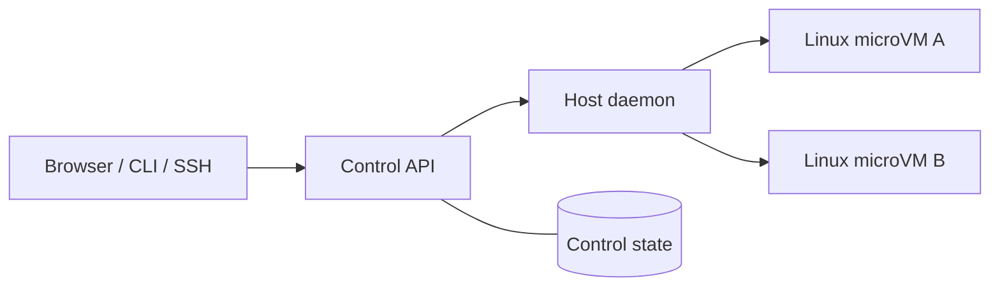

# Substrate

**Powerful, persistent cloud computers for AI agents.**

Run your existing agents in cloud workspaces with development tools, persistent files and browser access. Substrate handles workspace provisioning, access and state management so you can focus on the work instead of maintaining another machine.

[Live prototype](https://d13akhe938symg.cloudfront.net/) · [Pitch deck](https://drive.google.com/file/d/1bnsjCc7wtGdUVTyNM2Jkc_YZ0t5wMZhA/view?usp=sharing) · [Development guide](docs/development.md)

Built as a prototype for **AIBoomi Startup Weekend**.

## The idea

An agent needs a computer with tools, repositories, files and running services. Hosting that work on a laptop ties execution to the laptop's availability; moving it to a server introduces setup and ongoing administration.

Substrate provides a persistent home for that environment. Start a task, disconnect, and return from another device to inspect the work. Save the running state when you want to pause, or fork a prepared workspace to explore another approach independently.

The first users are developers and technical founders already using coding agents. The broader direction is managed compute for personal and business agent workloads.

## Demo

**[Open the hosted prototype →](https://d13akhe938symg.cloudfront.net/)**

Sign in to access the dashboard. Workspace operations use real compute and are subject to account quotas and available host capacity.

For a quick review, see the [pitch deck on Google Drive](https://drive.google.com/file/d/1bnsjCc7wtGdUVTyNM2Jkc_YZ0t5wMZhA/view?usp=sharing).

A typical walkthrough:

1. Create a Linux workspace from a repository or start with a blank environment.
2. Open a terminal and run a shell task or an authenticated coding agent.
3. Disconnect and return to the same session from another device.
4. Pause/resume the workspace, or inspect a prepared comparison and its verification results in the inbox.

## Capabilities

| Capability | What you can do |
| --- | --- |
| **Prepared Linux computers** | Run Docker, Git, Node, Bun, Python and compatible agent CLIs in a Firecracker microVM. |
| **Fast VM creation** | Create a workspace in under a second when a matching, never-used VM is ready in the warm pool. Cold creation remains available as a fallback. |
| **Multiple VM instances** | Keep separate workspaces for projects, agents and experiments, within account and host limits. |
| **Persistent work** | Reconnect to files, terminal sessions and retained scrollback while execution continues in the cloud. |
| **Pause, resume and fork** | Save memory and disk, resume the saved environment, or create independent workspace copies. A paused task makes no progress. |
| **GUI desktops** | Set up a browser-accessible Linux desktop for graphical tools and compatible computer-use agents. Separate Windows workspaces provide a desktop and PowerShell access. |
| **Tasks and results** | Run shell commands or supported agent prompts; inspect output, exit status, Git change summaries and optional verification results. |
| **Compare approaches** | Run two approaches from one saved environment, review the evidence, and choose which workspace to continue. |
| **Flexible access** | Use browser terminals, the user CLI, SSH or app previews. Users bring their own supported model access. |

Subsecond creation applies to ready warm-pool capacity. Pool misses cold-boot in roughly 2–3 seconds; repository setup and network transit add time. See the [measured warm-pool behavior and limits](https://github.com/harryfrzz/substrate/blob/253d836/docs/performance.md#warm-pool-new-workspaces-in-under-a-second).

Desktop environments and computer-use agents require their respective setup. Linux snapshot behavior and startup timings do not apply to Windows workspaces.

## How it works



The control service authenticates users, checks workspace ownership and quotas, and routes requests to the host. The host daemon manages Firecracker, copy-on-write ZFS disks, networking and snapshots. A guest daemon inside each Linux workspace owns terminal sessions and task execution independently of the browser connection.

The integrated prototype also includes jailed VMs, per-VM network namespaces and KMS-protected stored user keys. The current Linux deployment uses one shared host; multi-host fleet operation is a future step.

## Technology stack

| Layer | Tools |
| --- | --- |
| Web application | React, Vite, TypeScript, Tailwind CSS, xterm.js and noVNC |
| APIs and daemons | Bun, Hono and shared Zod protocol schemas |
| Workspace runtime | Firecracker/KVM, Ubuntu Linux, ZFS, systemd and Docker |
| Identity and secrets | Clerk, AWS KMS and Systems Manager Parameter Store |
| Control data | PostgreSQL on Amazon RDS in the integrated deployment; SQLite for local development and earlier revisions |
| Infrastructure | AWS EC2, CloudFront, S3 and Systems Manager, provisioned with AWS CDK in TypeScript |

## Local development

Requires **Bun 1.4.4 or newer**.

```sh
git clone https://github.com/harryfrzz/substrate.git
cd substrate
bun install
bun run dev
```

The web app runs at `http://localhost:5173` and the control API at `http://localhost:8080`. Without a configured sandbox host, the local app reports that no host is configured. Actual VM operations require the AWS/host setup described in the [development guide](docs/development.md).

Project checks:

```sh
bun run typecheck
bun test
bun run --filter @substrate/web build
```

## Prototype status and roadmap

Substrate is a working buildathon prototype. Availability depends on the deployed revision, guest image and configured integrations.

Next steps include reusable **use-case templates** for environments such as Next.js and Jupyter, paid billing, shared team controls and multi-host scheduling. Template launch and save-as-template are currently planned features.

## Documentation

- [Development and AWS setup](docs/development.md)
- [Control API configuration](docs/configuration.md)
- [Task inbox and fork-and-compare workflows](docs/agent-workflows.md)
- [VM lifecycle and workflow acceptance](docs/deployments/2026-10-24-agent-workflows.md)
- [Product plan and milestones](docs/plan.md)
- [Pitch deck](https://drive.google.com/file/d/1bnsjCc7wtGdUVTyNM2Jkc_YZ0t5wMZhA/view?usp=sharing)
